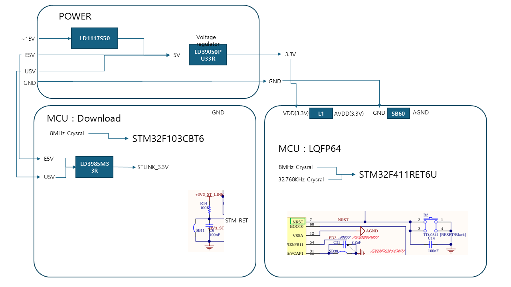
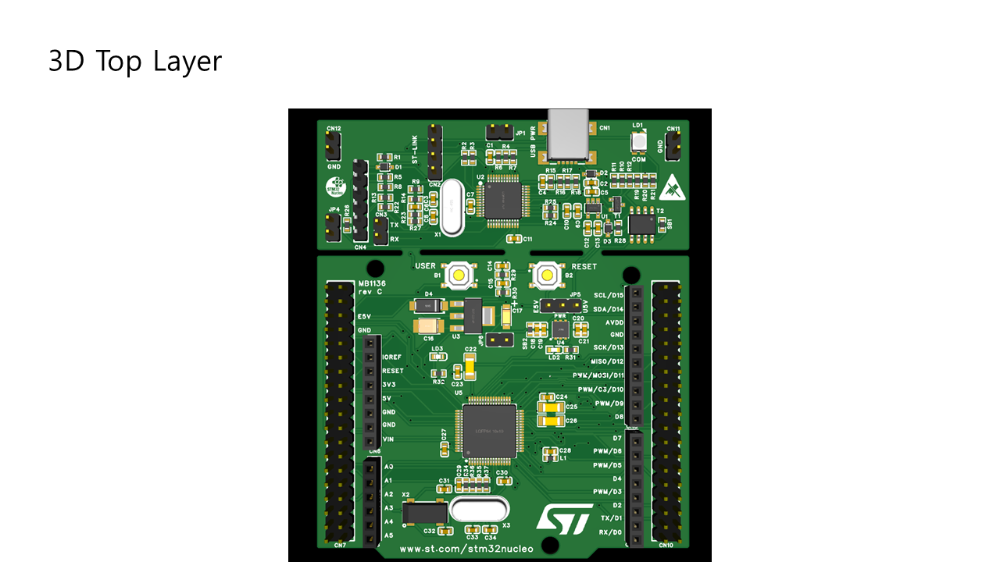
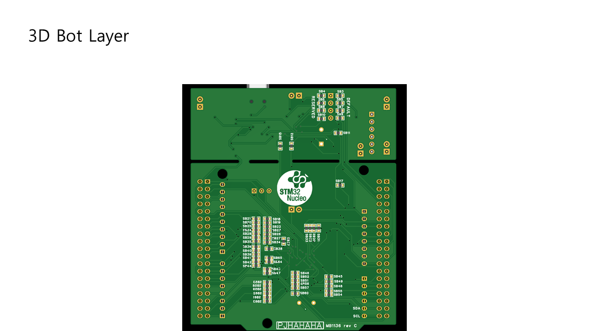

# github_basic
github_기초 사용 방법 정리

# H1 제목
## H2 제목  
### H3 제목
#### H4 제목
##### H5 제목
###### H6 제목

*이탤릭체* 또는 _이탤릭체_

**볼드체** 또는 __볼드체__

***볼드 이탤릭*** 또는 ___볼드 이탤릭___

~~취소선~~

`인라인 코드`

- 항목 1
- 항목 2
  - 하위 항목 1
  - 하위 항목 2
    - 더 깊은 하위 항목


1. 첫 번째 항목
2. 두 번째 항목
   1. 하위 항목 1
   2. 하위 항목 2
3. 세 번째 항목

[네이버](https://naver.com)


```javascript
function hello() {
    console.log('Hello World');
}
```
```python
def hello():
    print("Hello World")
```
```bash
npm install package-name
```

```
def hello():
    print("Hello World")
```

| 열1 | 열2 | 열3 |
|-----|-----|-----|
| 데이터1 | 데이터2 | 데이터3 |
| 데이터4 | 데이터5 | 데이터6 |

> 이것은 인용문입니다.
> 여러 줄의 인용문도 가능합니다.
>
> > 중첩된 인용문

## Chapter 1
---
## Chapter 2

$E = mc^2$ (인라인)

$$
\sum_{i=1}^{n} x_i = x_1 + x_2 + ... + x_n
$$


#STM32F411 Project

## Hardware

- 사진 첨부

 <br>

  <br>

- 사진 첨부 width, height 설정

<p align="center">
  
</p>

<p align="center">
  
</p>

<p align="center">
  
</p>

<p align="center">
  
</p>

<p align="center">
  
</p>

---

### 주소값 첨부
- [Datasheet - STM32F411xC STM32F411xE : Arm Cortex-M4 32b MCU+FPU, 125 DMIPS, 512KB Flash, 128KB RAM, USB OTG FS, 11 TIMs,1 ADC,13 comm. interfaces](https://www.st.com/resource/en/datasheet/stm32f411ce.pdf)
- [RM0383 Reference Manual : STM32F411xC/E advanced Arm  -based 32-bit MCUs](https://www.st.com/resource/en/reference_manual/rm0383-stm32f411xce-advanced-armbased-32bit-mcus-stmicroelectronics.pdf)

---

## 클릭시 자동 찾아가기
주의점: [ ]안에는 제목과 완전 동일하게 ( )은 제목과 동일하지만 특수문자 제외 및 띄어쓰기는 "-"으로 대체

### Table of Contents
- [1. Architecture](#1-architecture)
- [2. CLOCK](#2-clock)
- [3. MemoryMap](#3-memorymap)
- [4. Register](#4-register)
- [5. Test](#5-test)

### 1. Architecture

### 2. CLOCK

### 3. MemoryMap

### 4. Register

### 5. Test


## 목차
<details>
<summary>F411</summary>
</details>

### table

<table>
  <tr>
    <td align="center" width="40%">
      
    </td>
    <td align="center" width="40%">
      
    </td>
  </tr>
</table>

# table 제목 추가

<table>
  <tr>
    <th width="50%">HC-SR04 Sensor</th>
    <th width="50%">Circuit Schematic</th>
  </tr>
  <tr>
    <td align="center">
      
    </td>
    <td align="center">
      
    </td>
  </tr>
</table>


